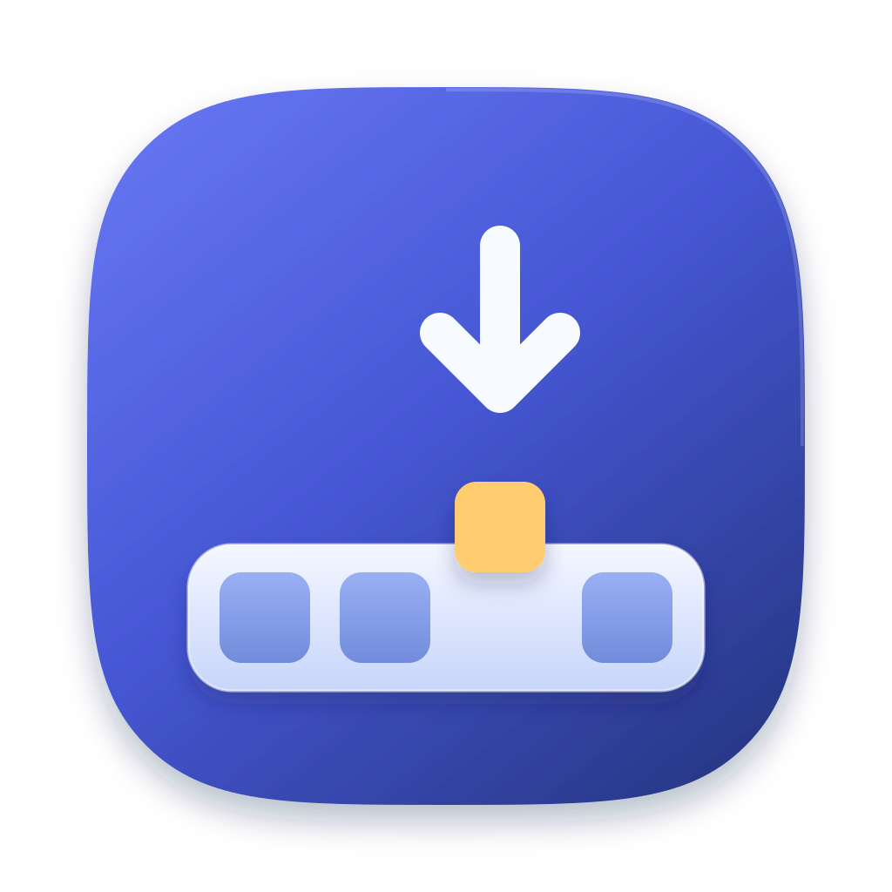

<p align="center">
  
</p>

<h1 align="center">DockUnstick</h1>

<p align="center">
  修复 macOS 切换全屏空间后，Dock 卡在悬停状态、不自动收回的问题。<br>
  A tiny menu bar app that un-sticks the macOS Dock after switching full-screen Spaces.
</p>

---

## 为什么写这个项目

升级到 macOS 27.2 之后，Dock 出现了一个能稳定复现的问题:

1. 在一个全屏应用里，把鼠标停在 Dock 的某个图标上；
2. 通过触控板左右滑动，或点击 Dock 图标，切换到另一个全屏应用；
3. 在切换动画进行时，把鼠标快速移到屏幕中间。

结果 Dock **一直显示着不收回**，那个图标的名称提示也一直挂着，就像鼠标还停在上面一样。只有把鼠标移回 Dock 再移开，或者执行 `killall Dock`，Dock 才会恢复，而且下次切换又会出现。社区里也有不少人报告了同样的问题，目前除了关闭放大效果，没有其他办法。

在 Apple 修复之前，DockUnstick 会在后台自动处理这个问题，不用你动手。

## 原因

通过监听窗口服务器发给 Dock 进程的事件，可以看到问题出在一个**被丢掉的"鼠标离开"事件**上。下面的类型 8 表示"鼠标进入"，类型 9 表示"鼠标离开"。

正常情况:
```
鼠标按下 → 抬起 → 9 鼠标离开（鼠标真的离开了 Dock）→ … → 8 鼠标进入（回到屏幕底边）
```

卡住的情况:
```
鼠标按下 → 抬起 → 9 鼠标离开（此时鼠标其实还在图标上！）
→ 切换 Space（鼠标此时才真正离开）→ 之后再也没有 8/9 事件
```

1. 切换开始时，窗口服务器**提前**给 Dock 发了"鼠标离开"，可鼠标实际还在图标上；
2. Dock 正在执行切换动画，**没有处理**这个事件，悬停状态保留了下来；
3. 切换结束后鼠标真的离开了，但窗口服务器认为"离开"已经发过，**不会再发**。

于是两边的状态对不上：窗口服务器认为鼠标早已离开，Dock 认为鼠标还停在图标上。

## 它做了什么

- **记录:** 用只监听的事件监听(`CGEvent.tapCreateForPid`)挂在 Dock 进程上，只订阅"进入/离开"两种事件，保存最近一次"鼠标离开"事件。
- **检测:** 每次切换 Space 后，在第 0.6、1.2、2.0 秒各检查一次。如果鼠标已经不在 Dock 上，但 Dock 仍有图标处于悬停状态，或者本该自动隐藏却仍然显示，就判定为卡住。
- **修复:** 把保存的"鼠标离开"事件复制一份，更新为当前时间和鼠标位置，投递给 Dock 进程(`CGEvent.postToPid`)。Dock 收到它漏掉的事件后，正常退出悬停并收回。

整个过程**不移动鼠标指针、不重启 Dock、不读取屏幕内容、不联网**。平时不轮询，只在切换 Space 后检查几次。所用接口都是公开 API。

在作者的机器上实测：卡住的情况 8/8 被修复，从切换 Space 到 Dock 收回大约 1 秒。

## 安装

需要 macOS 13 或更高版本，以及 Xcode 或 Xcode Command Line Tools(提供 `swiftc`)。

```bash
git clone https://github.com/LLP2333/dockUnstick.git
cd dockUnstick
./build.sh
```

建议先把编译出来的 `DockUnstick.app` 移到"应用程序"文件夹，再打开:

```bash
mv DockUnstick.app /Applications/
open /Applications/DockUnstick.app
```

### 授权辅助功能

首次打开时，DockUnstick 会弹出引导窗口：点「打开系统设置」，在 **隐私与安全性 → 辅助功能** 里打开 DockUnstick 的开关。窗口会自动检测到授权，之后就可以关掉了。

> 程序是本机临时签名(ad-hoc)的，**每次重新编译后，macOS 都会把它当成新程序**，旧的授权会失效。这时开关看起来是打开的，但其实没有生效。请用 **−** 删除 DockUnstick，再用 **+** 重新添加。

## 使用

DockUnstick 只在菜单栏显示一个图标，不出现在 Dock 里。菜单中可以:

- 查看运行状态，需要授权时也从这里打开引导窗口；
- 查看修复统计：累计次数、今天的次数、上次修复时间、失败次数；
- 开关「登录时自动启动」(使用系统的登录项，首次可能需要在 系统设置 → 通用 → 登录项 中允许)；
- 打开日志、重置统计、打开项目主页、退出。

## 设置

可以用 `defaults` 调整，修改后重启 DockUnstick 生效:

| 键 | 类型 | 默认值 | 说明 |
|---|---|---|---|
| `trace` | bool | `true` | 每次检查都把 Dock 状态写入日志 |
| `checkDelays` | 数组 | `0.6 1.2 2.0` | 切换 Space 后第几秒检查 Dock |

```bash
defaults write local.dockunstick trace -bool false
defaults write local.dockunstick checkDelays -array 0.4 1.0 2.0
```

日志位置：`~/Library/Logs/DockUnstick.log`

## 诊断模式

如果系统更新后修复失效了，下面两个模式能帮助定位原因:

```bash
# 60 秒内记录窗口服务器发给 Dock 的所有事件(鼠标移动事件只计数)
open DockUnstick.app --args --tap 60

# 8 秒后导出 Dock 的辅助功能信息(各图标的位置、悬停状态等)
open DockUnstick.app --args --dump 8
```

结果都写入上面的日志文件。运行前请先退出正在运行的 DockUnstick。

## 局限

- 这是绕过问题的办法，不是根治。根治需要 Apple 在 Dock 切换动画结束后重新检查鼠标位置。如果你也遇到了，欢迎通过「反馈助理」向 Apple 报告。
- 修复依赖 Dock 的事件格式（类型 9"鼠标离开"）。如果未来系统改了格式，修复可能失效，日志中会出现 `fix: replayexit did not help`。
- 判断 Dock 是否收回时，目前只考虑放在主显示器底部的 Dock。

## 卸载

1. 在菜单中关闭「登录时自动启动」，然后退出 DockUnstick；
2. 删除 `DockUnstick.app`；
3. 在 系统设置 → 隐私与安全性 → 辅助功能 中删除 DockUnstick；
4. 可选：清理设置、统计和日志:

```bash
defaults delete local.dockunstick
rm ~/Library/Logs/DockUnstick.log
```

## 许可证

[MIT](LICENSE)
